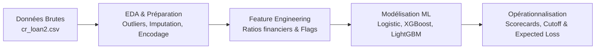

# Credit Risk Scoring — Machine Learning & Financial Risk Modeling

[](https://www.python.org/)
[](https://github.com/drissimohamed01/Credit-Risk-Scoring-)
[](LICENSE)

Pipeline complet d'analyse et de modélisation du risque de crédit pour les prêts à la consommation. Ce projet couvre l'ensemble du cycle de vie en Data Science Financière : de l'exploration des données et l'ingénierie des caractéristiques à l'optimisation des modèles de Machine Learning et leur traduction en décisions économiques concrètes (Probabilité de Défaut, Perte Attendue, Seuils d'Acceptation).

---

## 📑 Sommaire
- [Objectifs du Projet](#-objectifs-du-projet)
- [Architecture & Workflow](#-architecture--workflow)
- [Données Utilisées](#-données-utilisées)
- [Modélisation & Performances](#-modélisation--performances)
- [Impact Métier & Expected Loss](#-impact-métier--expected-loss)
- [Structure du Dépôt](#-structure-du-dépôt)
- [Installation & Utilisation](#-installation--utilisation)

---

## 🎯 Objectifs du Projet

1. **Prédiction du Défaut de Paiement** : Prédire avec précision la probabilité de défaut (`loan_status` : 0 = remboursement, 1 = défaut) à partir du profil de l'emprunteur et des caractéristiques du crédit.
2. **Arbitrage Risque / Rendement** : Trouver le seuil optimal de décision minimisant le taux de défaut tout en maximisant le volume de prêts octroyés aux profils solvables.
3. **Quantification Financière (Expected Loss)** : Calculer et ventiler la perte attendue ($EL = PD \times LGD \times EAD$) par tranche de risque.
4. **Interprétabilité et Conformité** : Fournir une traçabilité claire des décisions pour répondre aux standards de gestion du risque de crédit.

---

## 🔄 Architecture & Workflow

Le projet s'articule autour de 4 phases méthodologiques :



1. **Phase 1 : Exploration & Préparation des Données**
   - Analyse exploratoire détaillée (distributions, corrélations, analyse bivariée).
   - Traitement des valeurs manquantes (imputation médiane ciblée) et doublons.
   - Gestion des valeurs aberrantes par méthode IQR et winsorisation.
   - Encodage One-Hot des variables catégorielles et standardisation (`StandardScaler`).
   - Feature Engineering : ratios d'endettement (`loan_percent_income`, `income_to_loan_ratio`), flags d'antécédents (`prior_default_flag`, `short_credit_history`), charge financière annuelle.

2. **Phase 2 : Modélisation & Évaluation**
   - **Régression Logistique** : Modèle de référence interprétable avec régularisation.
   - **XGBoost Classifier** : Algorithme de gradient boosting optimisé pour capter les relations non-linéaires.
   - **LightGBM Classifier** : Modèle ensembliste haute performance avec gestion native des histogrammes.
   - Évaluation via **ROC-AUC**, **PR-AUC**, Courbe de Gain / Lift, et matrice de confusion.

3. **Phase 3 : Opérationnalisation Métier**
   - Segmentation de la clientèle en classes de risque (Faible, Modéré, Élevé, Critique).
   - Optimisation du seuil de décision (Cut-off) selon le coût économique d'un faux négatif vs faux positif.
   - Calcul de la perte attendue (**Expected Loss** : $EL = PD \times LGD \times EAD$).

4. **Phase 4 : Recommandations Stratégiques**
   - Grille de décision pour l'octroi automatique vs revue manuelle en comité de crédit.

---

## 📊 Données Utilisées

Le jeu de données `cr_loan2.csv` comprend plus de 32 000 demandes de crédit avec les variables clés suivantes :

| Variable | Type | Description |
| :--- | :--- | :--- |
| `person_age` | Numérique | Âge du demandeur d'emprunt |
| `person_income` | Numérique | Revenu annuel de l'emprunteur |
| `person_home_ownership` | Catégorielle | Statut résidentiel (`RENT`, `OWN`, `MORTGAGE`, etc.) |
| `person_emp_length` | Numérique | Ancienneté dans l'emploi (années) |
| `loan_intent` | Catégorielle | Motif du prêt (Consolidation, Éducation, Médical, etc.) |
| `loan_grade` | Catégorielle | Note interne de risque attribuée |
| `loan_amnt` | Numérique | Montant du crédit demandé |
| `loan_int_rate` | Numérique | Taux d'intérêt annuel appliqué |
| `loan_percent_income` | Numérique | Ratio montant emprunté / revenu annuel |
| `cb_person_default_on_file` | Catégorielle | Historique d'impayé enregistré (`Y` / `N`) |
| `cb_person_cred_hist_length` | Numérique | Ancienneté de l'historique de crédit (années) |
| **`loan_status`** | **Cible (0/1)** | **Statut du prêt : 0 = Bon payeur, 1 = Défaut** |

---

## 🚀 Modélisation & Performances

Les modèles ont été entraînés et évalués sur un découpage stratifié (Train / Test 80/20) :

| Modèle | ROC-AUC | Précision (Défaut) | Rappel (Défaut) | F1-Score |
| :--- | :---: | :---: | :---: | :---: |
| **Régression Logistique** | ~0.86 | ~0.72 | ~0.55 | ~0.62 |
| **LightGBM** | ~0.94 | ~0.86 | ~0.74 | ~0.79 |
| **XGBoost** | **~0.95** | **~0.88** | **~0.75** | **~0.81** |

*Les modèles d'ensemble (XGBoost et LightGBM) démontrent une capacité discriminante supérieure pour détecter les profils à risque tout en limitant les rejets indus de bons clients.*

---

## 💼 Impact Métier & Expected Loss

- **Réduction des Pertes** : L'implémentation du modèle XGBoost avec un cut-off calibré permet de capturer plus de 75% des défauts potentiels, réduisant significativement la charge pour créances douteuses.
- **Formule de Perte Attendue** :
  $$\text{Expected Loss (EL)} = \text{PD} \times \text{LGD} \times \text{EAD}$$
  *(avec une hypothèse standard de LGD = 45% selon les accords de Bâle).*
- **Grille d'Octroi** :
  - **PD < 10%** : Approbation automatique avec tarification bonifiée.
  - **10% ≤ PD < 30%** : Approbation conditionnelle (taux ajusté au risque).
  - **30% ≤ PD < 60%** : Revue manuelle avec garanties complémentaires exigées.
  - **PD ≥ 60%** : Rejet automatique.

---

## 📁 Structure du Dépôt

```
├── Credit_Risk_Scoring.ipynb          # Notebook Jupyter principal (workflow de A à Z)
├── cr_loan2.csv                       # Jeu de données des prêts (~32 000 enregistrements)
├── Presentation_Projet_Credit_Risk.pdf # Support de présentation synthétique (PDF)
├── generate_project_pdf.py            # Script Python de génération du rapport PDF
├── .gitattributes                     # Configuration des attributs Git (fichiers binaires)
└── README.md                          # Documentation du projet
```

---

## 🛠️ Installation & Utilisation

### Prérequis
- Python 3.9+
- Jupyter Notebook ou JupyterLab

### Installation de l'environnement

```bash
# Cloner le dépôt
git clone https://github.com/drissimohamed01/Credit-Risk-Scoring-.git
cd Credit-Risk-Scoring-

# Installer les dépendances
pip install numpy pandas scikit-learn xgboost lightgbm matplotlib seaborn reportlab
```

### Lancement du Notebook

```bash
jupyter notebook Credit_Risk_Scoring.ipynb
```

### Générer le PDF de synthèse

```bash
python generate_project_pdf.py
```

---

## 👤 Auteur
- **Mohammed Drissi** — [GitHub](https://github.com/drissimohamed01)
